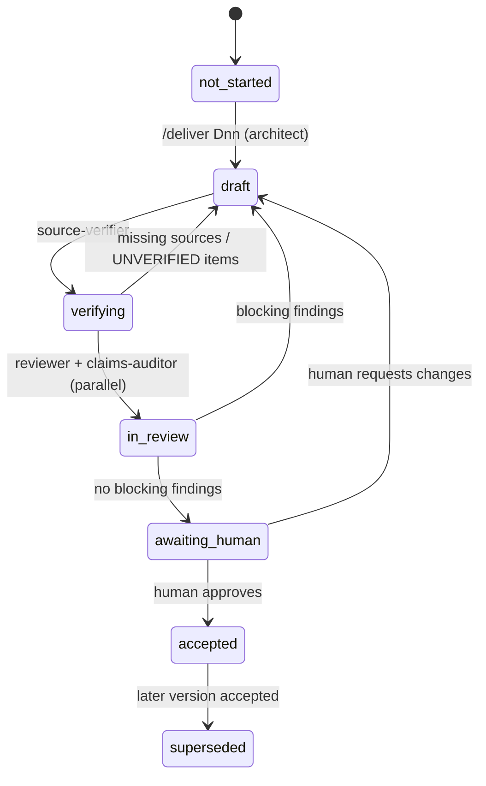

# Agentic workflow

This workflow is model-agnostic. Each step can run on a different model. The **files are the handoff**. No step assumes shared chat history.

## Roles

| Role | File | Writes | Reads |
|------|------|--------|-------|
| architect | `.pi/agents/architect.md` | Deliverable drafts, ADRs | Everything |
| source-verifier | `.pi/agents/source-verifier.md` | `SOURCES.md`, `FACTS_LEDGER.md`, `OPEN_QUESTIONS.md`, verification reports | Drafts, web |
| engineer | `.pi/agents/engineer.md` | Code and tests (implementation deliverables only) | Accepted designs |
| reviewer | `.pi/agents/reviewer.md` | Review reports only (read-only on sources) | Drafts, code |
| claims-auditor | `.pi/agents/claims-auditor.md` | Claims audit reports only | Drafts, ledgers |
| human | — | Approvals, license and naming decisions | Everything |

## Deliverable lifecycle

### Steps for `/deliver Dnn`

1. **Context check.** Read `specs/state.yaml`. Confirm that Dnn is the active epic and that all earlier deliverables are `accepted`. If not, stop and report.
2. **Draft** (architect). Write `docs/deliverables/Dnn-*.md` from the stub outline. Put intermediate notes in `_workspace/`.
3. **Verify** (source-verifier). Fetch the sources. Add S-IDs and F-IDs. Mark the rest UNVERIFIED and add OQs. Write `_workspace/Dnn_verify_report.md`.
4. **Review** (parallel): reviewer → `_workspace/Dnn_review_constraints.md`; claims-auditor → `_workspace/Dnn_review_claims.md`.
5. **Fix loop.** If a review has blocking findings, the architect revises. Maximum 2 loops, then escalate to the human.
6. **Gate.** Set the deliverable status to `in-review` in `specs/execution-status.yaml`. Write an update entry. **Stop.** Ask the human to approve.
7. **On approval.** Set the status to `accepted`, advance `specs/state.yaml` to the next epic, and add an entry to `CHANGELOG.md`.

### Implementation deliverables (D04, D05, D06, and code parts of D02, D03, D07, D08)

After the design is accepted, a separate design → code cycle runs:
`plan-work` (tasks in the epic capsule) → `kickoff-branch` → `develop-tdd` (engineer) → `verify-work` → `audit-code` → `request-review` (reviewer) → human gate → `release-branch`.

## Model switching rules

- Each agent file states its inputs and outputs. A new model needs only those files.
- Do not reference features of a specific model (special tags, tool names that only one vendor has, or "as Claude/GPT/Gemini…").
- If a model cannot run a tool (for example web fetch), it MUST mark the affected items UNVERIFIED. It MUST NOT guess.
- Record the role and the model used in the deliverable change log and in the update entry. This is for traceability, not for behavior.
